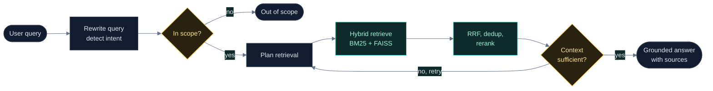

<div align="center">


<br/>

<a href="https://linkedin.com/in/narendranath-athota-3499a5259"></a>
<a href="mailto:athotanarendranath@gmail.com"></a>
<a href="https://github.com/narendranath0077?tab=repositories"></a>

</div>

<br/>

```text
narendranath@cgi:~$ cat now.txt

role        Associate Software Engineer, CGI (Bengaluru)
focus       agentic AI, enterprise RAG, evaluation, Python backends
building    Vantage: an agentic analytics platform with grounded answers
reading     MCP, and how agents behave under adversarial input
reach me    athotanarendranath@gmail.com
```

<br/>

<div align="center">


<br/>


</div>

<br/>

## How I work

- **Measure before claiming.** Retrieval and answer quality are scored (faithfulness, answer relevancy, context precision with RAGAS) against baselines, so an improvement is a number and not an impression.
- **Treat failure as a normal path.** Agents evaluate their own context and retry or re-plan retrieval, rather than answering confidently on weak evidence.
- **Validate at every boundary.** Pydantic schemas, whitelisted parameterised queries, and grounded responses with provenance, so the model is never trusted with more than it should be.

<br/>

## Featured work

<table>
  <tr>
    <td width="50%" valign="top">
      <h3>Vantage</h3>
      <sub>Agentic data analytics platform &nbsp;·&nbsp; Sep 2026</sub>
      <p>A LangGraph agent with tool calling that builds dashboards, answers natural-language questions about data, and generates insights. Runs on Ollama, Anthropic, or OpenAI models.</p>
      <p>The FastAPI backend is governed: semantic validation, whitelisted parameterised query execution, response grounding, and data provenance. Backed by 200+ automated tests and GitHub Actions CI.</p>
      <code>LangGraph</code> <code>FastAPI</code> <code>DuckDB</code> <code>Pydantic</code> <code>React</code><br/><br/>
      <a href="https://github.com/narendranath0077/dataviz"><b>Repository →</b></a>
    </td>
    <td width="50%" valign="top">
      <h3>Agentic RAG System</h3>
      <sub>Universal RAG chatbot &nbsp;·&nbsp; Jan 2026</sub>
      <p>A multi-step LangGraph pipeline: query rewriting, intent understanding, scope validation, dynamic retrieval planning, content evaluation, and retry. Ingests zips, directories, and mixed formats (PDF, DOCX, CSV, JSON, XLSX).</p>
      <p>Post-retrieval uses Reciprocal Rank Fusion, deduplication, and reranking, with a fallback when models cannot load offline.</p>
      <code>LangGraph</code> <code>FAISS</code> <code>BM25</code> <code>RAGAS</code> <code>FastAPI</code><br/><br/>
      <a href="https://github.com/narendranath0077/Universal-RAG-based-chatbot"><b>Repository →</b></a>
    </td>
  </tr>
  <tr>
    <td width="50%" valign="top">
      <h3>Multi-Agent Diet Planner</h3>
      <sub>Four coordinating agents with a feedback loop</sub>
      <p>A constraint analyser, meal generator, validator, and feedback handler exchange Pydantic-validated JSON to build plans from BMI, BMR, and TDEE. A SQLite loop tracks adherence and adapts later plans, and every output is schema-checked against macros, allergens, and cost.</p>
      <code>LangChain</code> <code>Pydantic</code> <code>SQLite</code><br/><br/>
      <a href="https://github.com/narendranath0077/Multi-Agent-AI-Diet-Planning-System-"><b>Repository →</b></a>
    </td>
    <td width="50%" valign="top">
      <h3>Oil Spill Detection</h3>
      <sub>Sentinel-1 SAR + AIS vessel data &nbsp;·&nbsp; B.Tech final-year project</sub>
      <p>Semantic segmentation of oil spills from satellite radar imagery fused with vessel-tracking data, designed to be real-time capable. UNet, DeepLabV3+, and a hybrid model were compared; the hybrid reached over 92% IoU.</p>
      <code>PyTorch</code> <code>UNet</code> <code>DeepLabV3+</code> <code>SAR</code><br/><br/>
      <a href="https://github.com/narendranath0077/Real-Time-Oil-Spill-Detection-Using-AIS-Satellite-Imagery"><b>Repository →</b></a>
    </td>
  </tr>
</table>

<br/>

### Agentic RAG: control flow



<br/>

## Experience

**Associate Software Engineer** &nbsp;·&nbsp; CGI, Bengaluru &nbsp;·&nbsp; *Sep 2026 – Present*

- Build code-analysis pipelines that use Tree-sitter parsing to generate UIRs and give agent tools structured code context, cutting token consumption by about 40%.
- Improve a Legacy Modernisation solution by refining application workflows, fixing functional issues, and raising execution reliability.
- Analyse product requirements, find gaps across pages, APIs, and workflows, and drive their implementation to support customer leads.
- Lead testing and deployment validation in customer environments: defect coordination, functional testing, client demonstrations, and release-readiness recommendations.

**Apprentice AI Developer** &nbsp;·&nbsp; CGI, Bengaluru &nbsp;·&nbsp; *Sep 2025 – Aug 2026*

- Built a modular enterprise Agentic RAG platform (LangGraph, ChromaDB, tool-calling agents) with ReAct workflows, self-evaluation, and retry across 5+ production use cases.
- Designed hybrid retrieval pipelines combining BM25, FAISS, and reranking, improving retrieval quality by 40% over baseline.
- Automated RAG evaluation with LangChain and RAGAS, scoring answer relevancy, faithfulness, and retrieval quality across 100+ enterprise documents, which cut manual review cycles by 40%.

<br/>

## Toolbox

<table>
  <tr>
    <td width="150"><b>Core</b></td>
    <td></td>
  </tr>
  <tr>
    <td><b>Platform</b></td>
    <td></td>
  </tr>
  <tr>
    <td><b>LLM and agents</b></td>
    <td>
      
      
      
      
      
      
    </td>
  </tr>
  <tr>
    <td><b>Retrieval and eval</b></td>
    <td>
      
      
      
      
      
      
      
    </td>
  </tr>
  <tr>
    <td><b>AI-assisted dev</b></td>
    <td>
      
      
      
    </td>
  </tr>
</table>

<br/>

## Credentials

| | |
|---|---|
| **B.Tech, Computer Science (Artificial Intelligence)** | KKR & KSR Institute of Technology and Sciences, Guntur · May 2025 |
| **Oracle Cloud Infrastructure 2025 Generative AI Professional** (1Z0-1127-25) | Oracle University · Oct 2025 |
| **Claude Code in Action** | Anthropic · Feb 2026 |

<br/>

## Activity

<div align="center">


</div>

<br/>

<div align="center">

**Working on LLM systems, RAG, or evaluation? I'd like to hear about it.**

<a href="https://linkedin.com/in/narendranath-athota-3499a5259"></a>
<a href="mailto:athotanarendranath@gmail.com"></a>

<sub>Where it started: <a href="https://github.com/narendranath0077/NEXUS---Voice-Based-AI-Assistant">NEXUS</a>, a Python voice assistant built to see if I could make something that talks back.</sub>


</div>
