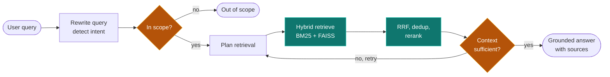
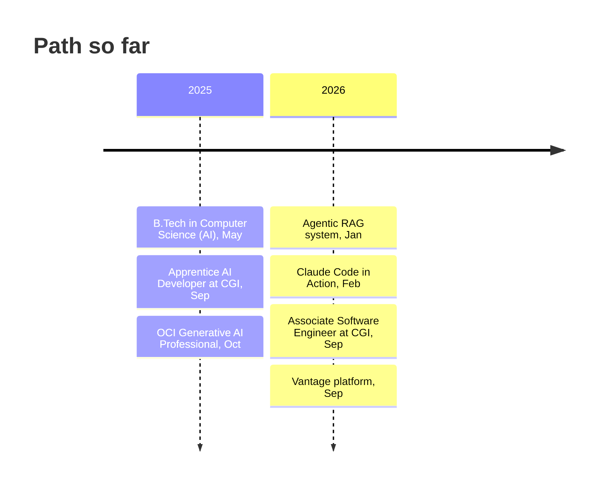

<h1 align="center">Narendranath Athota</h1>

<p align="center">
  <b>AI Engineer</b> &nbsp;·&nbsp; Agentic AI &nbsp;·&nbsp; Enterprise RAG &nbsp;·&nbsp; LLM Evaluation<br/>
  Associate Software Engineer at CGI, Bengaluru
</p>

<p align="center">
  
</p>

<p align="center">
  <a href="https://linkedin.com/in/narendranath-athota-3499a5259"></a>
  <a href="mailto:athotanarendranath@gmail.com"></a>
  <a href="https://github.com/narendranath0077?tab=repositories"></a>
</p>

<br/>

```text
narendranath@cgi:~$ cat now.txt

role        Associate Software Engineer, CGI (Bengaluru)
focus       agentic AI, enterprise RAG, evaluation, Python backends
building    Vantage, an agentic analytics platform with grounded answers
reading     MCP, and how agents behave under adversarial input
reach me    athotanarendranath@gmail.com
```

<p align="center">
  
  
  <br/>
  
  
  
</p>

<br/>

## How I work

- **Measure before claiming.** Answer quality is scored with RAGAS (faithfulness, answer relevancy, context precision) against a baseline, so an improvement is a number and not an impression.
- **Treat failure as a normal path.** Agents evaluate their own retrieved context and retry, rather than answering confidently on weak evidence.
- **Validate at every boundary.** Pydantic schemas, whitelisted parameterised queries, and grounded responses with provenance, so a model is never trusted with more than it should be.

<br/>

## Featured work

<table>
  <tr>
    <td width="50%" valign="top">
      <h3>Vantage</h3>
      <sub>Agentic data analytics platform &nbsp;·&nbsp; Sep 2026</sub>
      <p>A LangGraph agent with tool calling that builds dashboards, answers natural-language questions about data, and generates insights. Runs on Ollama, Anthropic, or OpenAI models.</p>
      <p>The FastAPI backend is governed: semantic validation, whitelisted parameterised query execution, response grounding, and data provenance. Backed by 200+ automated tests and GitHub Actions CI.</p>
      <code>LangGraph</code> <code>FastAPI</code> <code>DuckDB</code> <code>Pydantic</code> <code>React</code><br/><br/>
      <a href="https://github.com/narendranath0077/dataviz"><b>Repository →</b></a>
    </td>
    <td width="50%" valign="top">
      <h3>Agentic RAG System</h3>
      <sub>Universal RAG chatbot &nbsp;·&nbsp; Jan 2026</sub>
      <p>A multi-step LangGraph pipeline: query rewriting, intent understanding, scope validation, dynamic retrieval planning, content evaluation, and retry. Ingests zips, directories, and mixed formats (PDF, DOCX, CSV, JSON, XLSX).</p>
      <p>Post-retrieval uses Reciprocal Rank Fusion, deduplication, and mode-based answer generation to return grounded responses.</p>
      <code>LangGraph</code> <code>FAISS</code> <code>BM25</code> <code>RAGAS</code> <code>FastAPI</code><br/><br/>
      <a href="https://github.com/narendranath0077/Universal-RAG-based-chatbot"><b>Repository →</b></a>
    </td>
  </tr>
  <tr>
    <td width="50%" valign="top">
      <h3>Multi-Agent Diet Planner</h3>
      <sub>Four coordinating agents with a feedback loop</sub>
      <p>A constraint analyser, meal generator, validator, and feedback handler exchange Pydantic-validated JSON to build plans from BMI, BMR, and TDEE. A SQLite loop tracks adherence and adapts later plans, and every output is schema-checked against macros, allergens, and cost.</p>
      <code>LangChain</code> <code>Pydantic</code> <code>SQLite</code><br/><br/>
      <a href="https://github.com/narendranath0077/Multi-Agent-AI-Diet-Planning-System-"><b>Repository →</b></a>
    </td>
    <td width="50%" valign="top">
      <h3>Oil Spill Detection</h3>
      <sub>Sentinel-1 SAR + AIS vessel data &nbsp;·&nbsp; B.Tech final-year project</sub>
      <p>Semantic segmentation of oil spills from satellite radar imagery fused with vessel-tracking data, designed to be real-time capable. UNet, DeepLabV3+, and a hybrid model were compared, and the hybrid reached over 92% IoU.</p>
      <code>PyTorch</code> <code>UNet</code> <code>DeepLabV3+</code> <code>SAR</code><br/><br/>
      <a href="https://github.com/narendranath0077/Real-Time-Oil-Spill-Detection-Using-AIS-Satellite-Imagery"><b>Repository →</b></a>
    </td>
  </tr>
</table>

<br/>

## Retrieval, up close

Hybrid retrieval starts wide and narrows. The model below is interactive: drag to rotate, scroll to zoom. From the bottom plate up, it shows the candidate pool from BM25 and FAISS, the pool after fusion and deduplication, the reranked shortlist, and the final context the model is allowed to see.

```stl
solid retrieval_funnel
  facet normal 0.0 0.0 -1.0
    outer loop
      vertex -5.00 -5.00 0.00
      vertex -5.00 5.00 0.00
      vertex 5.00 5.00 0.00
    endloop
  endfacet
  facet normal 0.0 0.0 -1.0
    outer loop
      vertex -5.00 -5.00 0.00
      vertex 5.00 5.00 0.00
      vertex 5.00 -5.00 0.00
    endloop
  endfacet
  facet normal 0.0 0.0 1.0
    outer loop
      vertex -5.00 -5.00 0.60
      vertex 5.00 -5.00 0.60
      vertex 5.00 5.00 0.60
    endloop
  endfacet
  facet normal 0.0 0.0 1.0
    outer loop
      vertex -5.00 -5.00 0.60
      vertex 5.00 5.00 0.60
      vertex -5.00 5.00 0.60
    endloop
  endfacet
  facet normal 0.0 -1.0 0.0
    outer loop
      vertex -5.00 -5.00 0.00
      vertex 5.00 -5.00 0.00
      vertex 5.00 -5.00 0.60
    endloop
  endfacet
  facet normal 0.0 -1.0 0.0
    outer loop
      vertex -5.00 -5.00 0.00
      vertex 5.00 -5.00 0.60
      vertex -5.00 -5.00 0.60
    endloop
  endfacet
  facet normal 1.0 0.0 0.0
    outer loop
      vertex 5.00 -5.00 0.00
      vertex 5.00 5.00 0.00
      vertex 5.00 5.00 0.60
    endloop
  endfacet
  facet normal 1.0 0.0 0.0
    outer loop
      vertex 5.00 -5.00 0.00
      vertex 5.00 5.00 0.60
      vertex 5.00 -5.00 0.60
    endloop
  endfacet
  facet normal 0.0 1.0 0.0
    outer loop
      vertex 5.00 5.00 0.00
      vertex -5.00 5.00 0.00
      vertex -5.00 5.00 0.60
    endloop
  endfacet
  facet normal 0.0 1.0 -0.0
    outer loop
      vertex 5.00 5.00 0.00
      vertex -5.00 5.00 0.60
      vertex 5.00 5.00 0.60
    endloop
  endfacet
  facet normal -1.0 0.0 0.0
    outer loop
      vertex -5.00 5.00 0.00
      vertex -5.00 -5.00 0.00
      vertex -5.00 -5.00 0.60
    endloop
  endfacet
  facet normal -1.0 0.0 0.0
    outer loop
      vertex -5.00 5.00 0.00
      vertex -5.00 -5.00 0.60
      vertex -5.00 5.00 0.60
    endloop
  endfacet
  facet normal 0.0 0.0 -1.0
    outer loop
      vertex -3.70 -3.70 1.50
      vertex -3.70 3.70 1.50
      vertex 3.70 3.70 1.50
    endloop
  endfacet
  facet normal 0.0 0.0 -1.0
    outer loop
      vertex -3.70 -3.70 1.50
      vertex 3.70 3.70 1.50
      vertex 3.70 -3.70 1.50
    endloop
  endfacet
  facet normal 0.0 0.0 1.0
    outer loop
      vertex -3.70 -3.70 2.10
      vertex 3.70 -3.70 2.10
      vertex 3.70 3.70 2.10
    endloop
  endfacet
  facet normal 0.0 0.0 1.0
    outer loop
      vertex -3.70 -3.70 2.10
      vertex 3.70 3.70 2.10
      vertex -3.70 3.70 2.10
    endloop
  endfacet
  facet normal 0.0 -1.0 0.0
    outer loop
      vertex -3.70 -3.70 1.50
      vertex 3.70 -3.70 1.50
      vertex 3.70 -3.70 2.10
    endloop
  endfacet
  facet normal 0.0 -1.0 0.0
    outer loop
      vertex -3.70 -3.70 1.50
      vertex 3.70 -3.70 2.10
      vertex -3.70 -3.70 2.10
    endloop
  endfacet
  facet normal 1.0 0.0 0.0
    outer loop
      vertex 3.70 -3.70 1.50
      vertex 3.70 3.70 1.50
      vertex 3.70 3.70 2.10
    endloop
  endfacet
  facet normal 1.0 0.0 0.0
    outer loop
      vertex 3.70 -3.70 1.50
      vertex 3.70 3.70 2.10
      vertex 3.70 -3.70 2.10
    endloop
  endfacet
  facet normal 0.0 1.0 0.0
    outer loop
      vertex 3.70 3.70 1.50
      vertex -3.70 3.70 1.50
      vertex -3.70 3.70 2.10
    endloop
  endfacet
  facet normal 0.0 1.0 -0.0
    outer loop
      vertex 3.70 3.70 1.50
      vertex -3.70 3.70 2.10
      vertex 3.70 3.70 2.10
    endloop
  endfacet
  facet normal -1.0 0.0 0.0
    outer loop
      vertex -3.70 3.70 1.50
      vertex -3.70 -3.70 1.50
      vertex -3.70 -3.70 2.10
    endloop
  endfacet
  facet normal -1.0 0.0 0.0
    outer loop
      vertex -3.70 3.70 1.50
      vertex -3.70 -3.70 2.10
      vertex -3.70 3.70 2.10
    endloop
  endfacet
  facet normal 0.0 0.0 -1.0
    outer loop
      vertex -2.45 -2.45 3.00
      vertex -2.45 2.45 3.00
      vertex 2.45 2.45 3.00
    endloop
  endfacet
  facet normal 0.0 0.0 -1.0
    outer loop
      vertex -2.45 -2.45 3.00
      vertex 2.45 2.45 3.00
      vertex 2.45 -2.45 3.00
    endloop
  endfacet
  facet normal 0.0 0.0 1.0
    outer loop
      vertex -2.45 -2.45 3.60
      vertex 2.45 -2.45 3.60
      vertex 2.45 2.45 3.60
    endloop
  endfacet
  facet normal 0.0 0.0 1.0
    outer loop
      vertex -2.45 -2.45 3.60
      vertex 2.45 2.45 3.60
      vertex -2.45 2.45 3.60
    endloop
  endfacet
  facet normal 0.0 -1.0 0.0
    outer loop
      vertex -2.45 -2.45 3.00
      vertex 2.45 -2.45 3.00
      vertex 2.45 -2.45 3.60
    endloop
  endfacet
  facet normal 0.0 -1.0 0.0
    outer loop
      vertex -2.45 -2.45 3.00
      vertex 2.45 -2.45 3.60
      vertex -2.45 -2.45 3.60
    endloop
  endfacet
  facet normal 1.0 0.0 0.0
    outer loop
      vertex 2.45 -2.45 3.00
      vertex 2.45 2.45 3.00
      vertex 2.45 2.45 3.60
    endloop
  endfacet
  facet normal 1.0 0.0 0.0
    outer loop
      vertex 2.45 -2.45 3.00
      vertex 2.45 2.45 3.60
      vertex 2.45 -2.45 3.60
    endloop
  endfacet
  facet normal 0.0 1.0 0.0
    outer loop
      vertex 2.45 2.45 3.00
      vertex -2.45 2.45 3.00
      vertex -2.45 2.45 3.60
    endloop
  endfacet
  facet normal 0.0 1.0 -0.0
    outer loop
      vertex 2.45 2.45 3.00
      vertex -2.45 2.45 3.60
      vertex 2.45 2.45 3.60
    endloop
  endfacet
  facet normal -1.0 0.0 0.0
    outer loop
      vertex -2.45 2.45 3.00
      vertex -2.45 -2.45 3.00
      vertex -2.45 -2.45 3.60
    endloop
  endfacet
  facet normal -1.0 0.0 0.0
    outer loop
      vertex -2.45 2.45 3.00
      vertex -2.45 -2.45 3.60
      vertex -2.45 2.45 3.60
    endloop
  endfacet
  facet normal 0.0 0.0 -1.0
    outer loop
      vertex -1.30 -1.30 4.50
      vertex -1.30 1.30 4.50
      vertex 1.30 1.30 4.50
    endloop
  endfacet
  facet normal 0.0 0.0 -1.0
    outer loop
      vertex -1.30 -1.30 4.50
      vertex 1.30 1.30 4.50
      vertex 1.30 -1.30 4.50
    endloop
  endfacet
  facet normal 0.0 0.0 1.0
    outer loop
      vertex -1.30 -1.30 5.10
      vertex 1.30 -1.30 5.10
      vertex 1.30 1.30 5.10
    endloop
  endfacet
  facet normal 0.0 0.0 1.0
    outer loop
      vertex -1.30 -1.30 5.10
      vertex 1.30 1.30 5.10
      vertex -1.30 1.30 5.10
    endloop
  endfacet
  facet normal 0.0 -1.0 0.0
    outer loop
      vertex -1.30 -1.30 4.50
      vertex 1.30 -1.30 4.50
      vertex 1.30 -1.30 5.10
    endloop
  endfacet
  facet normal 0.0 -1.0 0.0
    outer loop
      vertex -1.30 -1.30 4.50
      vertex 1.30 -1.30 5.10
      vertex -1.30 -1.30 5.10
    endloop
  endfacet
  facet normal 1.0 0.0 0.0
    outer loop
      vertex 1.30 -1.30 4.50
      vertex 1.30 1.30 4.50
      vertex 1.30 1.30 5.10
    endloop
  endfacet
  facet normal 1.0 0.0 0.0
    outer loop
      vertex 1.30 -1.30 4.50
      vertex 1.30 1.30 5.10
      vertex 1.30 -1.30 5.10
    endloop
  endfacet
  facet normal 0.0 1.0 0.0
    outer loop
      vertex 1.30 1.30 4.50
      vertex -1.30 1.30 4.50
      vertex -1.30 1.30 5.10
    endloop
  endfacet
  facet normal 0.0 1.0 -0.0
    outer loop
      vertex 1.30 1.30 4.50
      vertex -1.30 1.30 5.10
      vertex 1.30 1.30 5.10
    endloop
  endfacet
  facet normal -1.0 0.0 0.0
    outer loop
      vertex -1.30 1.30 4.50
      vertex -1.30 -1.30 4.50
      vertex -1.30 -1.30 5.10
    endloop
  endfacet
  facet normal -1.0 0.0 0.0
    outer loop
      vertex -1.30 1.30 4.50
      vertex -1.30 -1.30 5.10
      vertex -1.30 1.30 5.10
    endloop
  endfacet
endsolid retrieval_funnel
```

And the control flow around it, including the retry path:



<br/>

## Experience



**Associate Software Engineer** &nbsp;·&nbsp; CGI, Bengaluru &nbsp;·&nbsp; *Sep 2026 – Present*

- Build code-analysis pipelines that use Tree-sitter parsing to generate UIRs and give agent tools structured code context, cutting token consumption by about 40%.
- Improve a Legacy Modernisation solution by refining application workflows, fixing functional issues, and raising execution reliability.
- Analyse product requirements, find gaps across pages, APIs, and workflows, and drive their implementation to support customer leads.
- Lead testing and deployment validation in customer environments: defect coordination, functional testing, client demonstrations, and release-readiness recommendations.

**Apprentice AI Developer** &nbsp;·&nbsp; CGI, Bengaluru &nbsp;·&nbsp; *Sep 2025 – Aug 2026*

- Built a modular enterprise Agentic RAG platform (LangGraph, ChromaDB, tool-calling agents) with ReAct workflows, self-evaluation, and retry across 5+ production use cases.
- Designed hybrid retrieval pipelines combining BM25, FAISS, and reranking, improving retrieval quality by 40% over baseline.
- Automated RAG evaluation with LangChain and RAGAS, scoring answer relevancy, faithfulness, and retrieval quality across 100+ enterprise documents, which cut manual review cycles by 40%.

<br/>

## Toolbox

<table>
  <tr>
    <td width="170" valign="top"><b>LLM and agents</b></td>
    <td>
      
      
      
      
      
      
      
    </td>
  </tr>
  <tr>
    <td valign="top"><b>Retrieval and evaluation</b></td>
    <td>
      
      
      
      
      
    </td>
  </tr>
  <tr>
    <td valign="top"><b>Backend and data</b></td>
    <td>
      
      
      
      
      
      
      
      
      
    </td>
  </tr>
  <tr>
    <td valign="top"><b>ML and deep learning</b></td>
    <td>
      
      
      
      
    </td>
  </tr>
  <tr>
    <td valign="top"><b>Cloud and delivery</b></td>
    <td>
      
      
      
      
      
    </td>
  </tr>
  <tr>
    <td valign="top"><b>AI-assisted development</b></td>
    <td>
      
      
      
    </td>
  </tr>
</table>

<sub>Also: Tree-sitter, JWT and RBAC, Alembic, Polars, Transformers, CNNs, Azure DevOps, prompt engineering, fine-tuning.</sub>

<br/>

## Credentials

| | |
|---|---|
| **B.Tech, Computer Science (Artificial Intelligence)** | KKR & KSR Institute of Technology and Sciences, Guntur · May 2025 |
| **Oracle Cloud Infrastructure 2025 Generative AI Professional** (1Z0-1127-25) | Oracle University · Oct 2025 |
| **Claude Code in Action** | Anthropic · Feb 2026 |

<br/>

## Get in touch

If you are working on LLM systems, RAG, or evaluation, I would like to hear about it.

<p>
  <a href="https://linkedin.com/in/narendranath-athota-3499a5259"></a>
  <a href="mailto:athotanarendranath@gmail.com"></a>
</p>

```geojson
{
  "type": "FeatureCollection",
  "features": [
    {
      "type": "Feature",
      "properties": { "title": "Bengaluru, India", "marker-color": "#0f766e" },
      "geometry": { "type": "Point", "coordinates": [77.5946, 12.9716] }
    }
  ]
}
```

<sub>Where it started: <a href="https://github.com/narendranath0077/NEXUS---Voice-Based-AI-Assistant">NEXUS</a>, a Python voice assistant built to see if I could make something that talks back.</sub>
